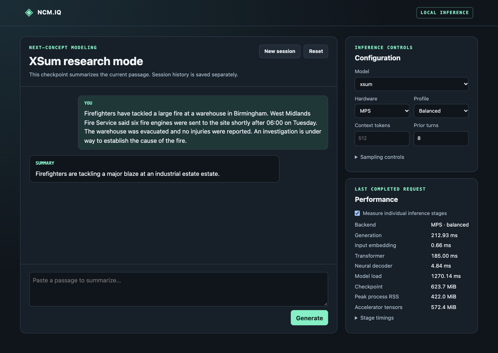
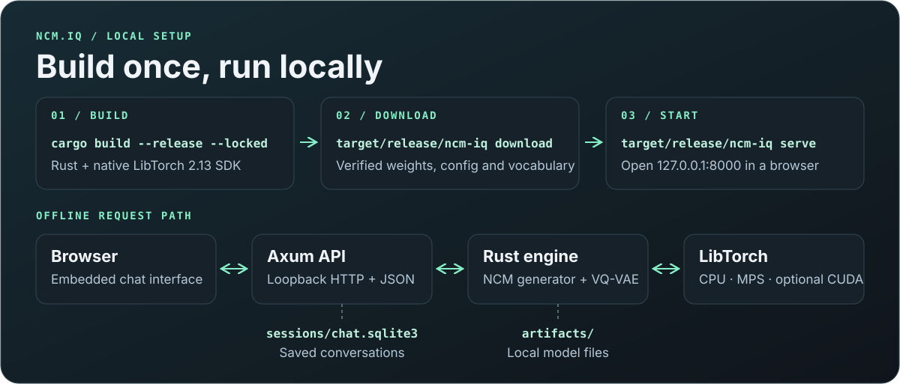
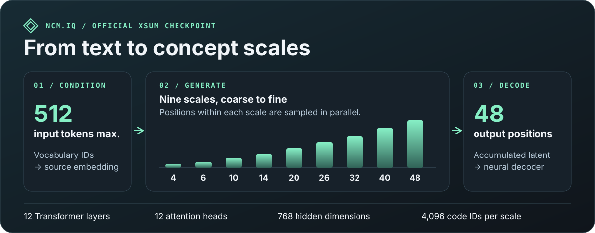
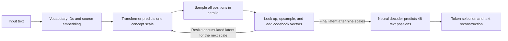
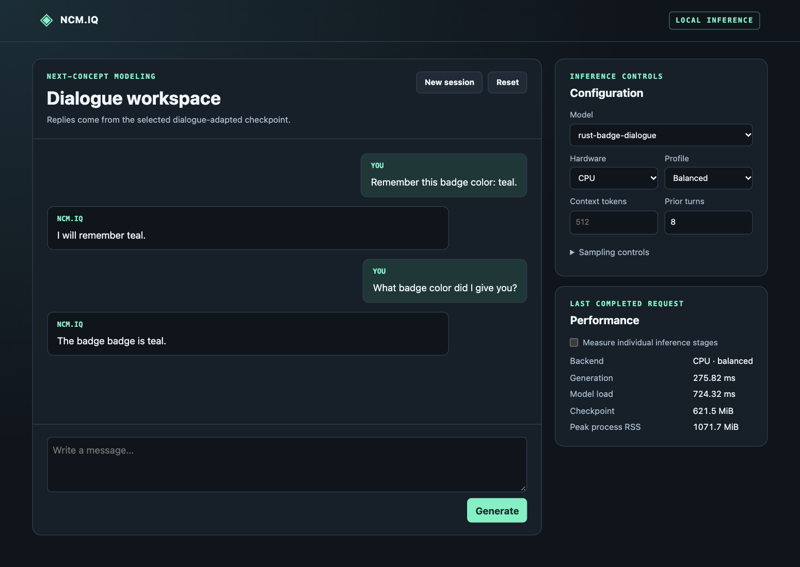

# NCM.IQ

NCM.IQ is a Rust inference engine, local web app, and dialogue adaptation tool for Next-Concept Modeling. The Transformer predicts a full scale of concept codes in parallel, and a multiscale residual VQ-VAE decodes the accumulated latent into text. The executable loads the official XSum checkpoint directly. [NCM paper](https://arxiv.org/pdf/2610.14162v1)



*The running web app with the official XSum checkpoint, Balanced inference on Apple MPS, and stage profiling enabled. The reply and timings are from the captured request.*

## Quick start

Install Rust 1.99 or newer, a C++20 toolchain, `curl`, `unzip`, and `shasum`. The Apple Silicon SDK setup also uses `jq`. The setup script downloads and verifies the native LibTorch 2.13 SDK for Apple Silicon macOS and Linux on x86-64 or ARM64.

```sh
LIBTORCH=$(bash scripts/libtorch.sh)
export LIBTORCH
cargo build --release --locked

target/release/ncm-iq download
target/release/ncm-iq serve
```

Open [the local interface](http://127.0.0.1:8000). The download command verifies the pinned checkpoint and vocabulary files and reuses verified local copies. The official checkpoint pair occupies 624 MiB. Once those files are available, inference, serving, benchmarks, and dialogue adaptation run offline.

The server binds to loopback and saves sessions in `sessions/chat.sqlite3`. Use `serve --help` to choose another model directory, vocabulary, session database, or port. [Local HTTP API](docs/api.md)



## How the model works



<details>
<summary>Follow a request through the model</summary>



</details>

1. **Condition on the source.** The text vocabulary maps the input to IDs. A learned embedding supplies the source features. Balanced evaluates the source and first concept scale together and reuses the source keys and values at later scales.
2. **Refine the latent.** Each scale predicts all its positions in parallel. The engine looks up the sampled code vectors, upsamples their contribution and adds it to the accumulated residual latent used by the next scale.
3. **Decode the output.** The VQ-VAE decoder reads the final latent and predicts 48 text positions. Token selection and the text vocabulary turn those predictions into the visible reply.

The full VQ-VAE encoder and nearest-code search run when reconstructing text or preparing training targets. The scale widths and model dimensions above come from the shipped XSum configuration. [Architecture](docs/architecture.md) · [XSum configuration](configs/xsum.yaml)

## Models and backends

The official XSum checkpoint summarizes the current passage. Dialogue-adapted checkpoints can use earlier turns as context. The current engine supports XSum and dialogue checkpoints derived from its architecture.

CPU and Apple MPS were verified on an M2. Automatic selection chooses an available accelerator and falls back to CPU. CUDA requires a compatible LibTorch SDK and remains pending hardware validation.

| Profile | Behavior |
|---|---|
| Quality | FP32, full padded-prefix evaluation at every scale. |
| Balanced | FP32, combined prefix and first scale, reusable prefix K/V, and cached exact RVQ norms. |
| Ultra-light | Experimental CPU dynamic INT8 linears or MPS FP16 decoder projection. |

```sh
target/release/ncm-iq generate --backend cpu "The library opens its reading room on Monday."
target/release/ncm-iq reconstruct --backend mps "Exact RVQ reconstruction runs locally."
```

## Benchmarks and tests

With the combined prefix and first-scale pass, Balanced inference measured a median of **237.5 ms on CPU** and **117.3 ms on MPS** on the Apple M2. All 18 concept and token arrays per backend matched the previous Balanced path. [Methodology and results](docs/performance.md)

```sh
target/release/ncm-iq benchmark --backend cpu --profile quality --output results/quality.json
target/release/ncm-iq benchmark --backend cpu --profile balanced --output results/balanced.json
target/release/ncm-iq compare results/quality.json results/balanced.json

cargo fmt --all -- --check
cargo clippy --locked --all-targets -- -D warnings
cargo test --locked
cargo test --release --locked --test official -- --ignored
```

The last command requires the official checkpoints in `artifacts/` or the directory set by `NCM_TEST_ARTIFACTS`. CI runs lint and unit tests. The manual benchmark workflow adds the official checkpoint test and runs each profile in a fresh process.

## Adapt for dialogue

```sh
target/release/ncm-iq train --backend cpu --train training/smoke.jsonl \
  --output artifacts/my-dialogue --steps 240 --learning-rate 0.002
target/release/ncm-iq serve
```

Use a fresh output directory and select the resulting model in the web interface. The smoke corpus verifies the training and dialogue pipeline. General dialogue quality requires a separate held-out evaluation. [Data format, training options, and measured smoke results](docs/dialogue.md)



*Two live requests with the heads-only `rust-badge-dialogue` smoke checkpoint. Teal is one of its training examples.*

## Repository layout

| Path | Contents |
|---|---|
| `src/` | Rust inference engine, Axum API, SQLite sessions, trainer, and benchmark CLI. Small C++ bindings expose LibTorch MPS telemetry and packed INT8 linears. |
| `frontend/` | Browser assets embedded in the executable. |
| `benchmarks/`, `training/` | Benchmark prompts and the dialogue smoke corpus. |
| `tests/`, `.github/workflows/` | Official-checkpoint regression test, CI, and benchmark automation. |
| `docs/` | [Architecture](docs/architecture.md), [research and licensing](docs/research-audit.md), [optimization notes](docs/optimization-research.md), and [roadmap](docs/optimization-roadmap.md). |

MIT. The [license](LICENSE) preserves the upstream Hazy Research notice.
