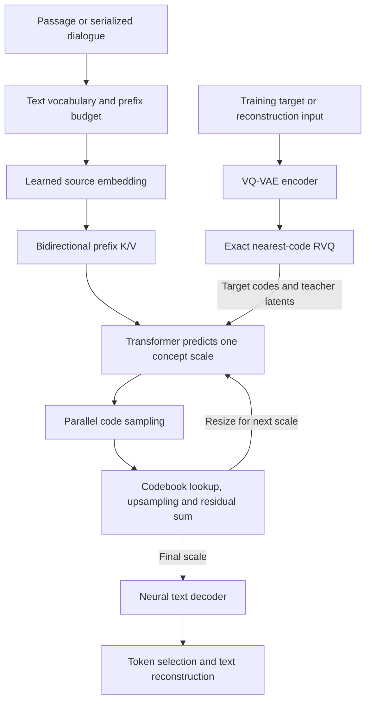

# Architecture

XSum uses a 12-layer, 12-head, 768-wide generator. Its nine scales expand from four to 48 positions. Each stage samples a complete code sequence before the next stage. The target positions attend to one another within the scale and to the bidirectional source. Source queries see only the source, which makes their layer-wise keys and values reusable across scales. Earlier target scales are summarized by the cumulative residual and do not enter the attention cache. RoPE positions reset at every target scale.

The trained VQ-VAE preserves the released 384-dimensional codebooks, learned coarse sampling, residual convolutions, and parallel vocabulary projection. Source generation uses a raw embedding in XSum. The complete encoder and nearest-neighbor search run for dialogue supervision and the reconstruction benchmark. The text vocabulary is the text interface to that neural tokenizer.

The app owns a single loaded model per process and replaces it on a model, device or profile change. A request copies current session history, runs generation, and commits both messages only if the SQLite revision is unchanged. Concurrent sends or resets return a conflict. The UI displays synchronized stage measurements for the last successful request. Generation produces the complete response in one API response.
